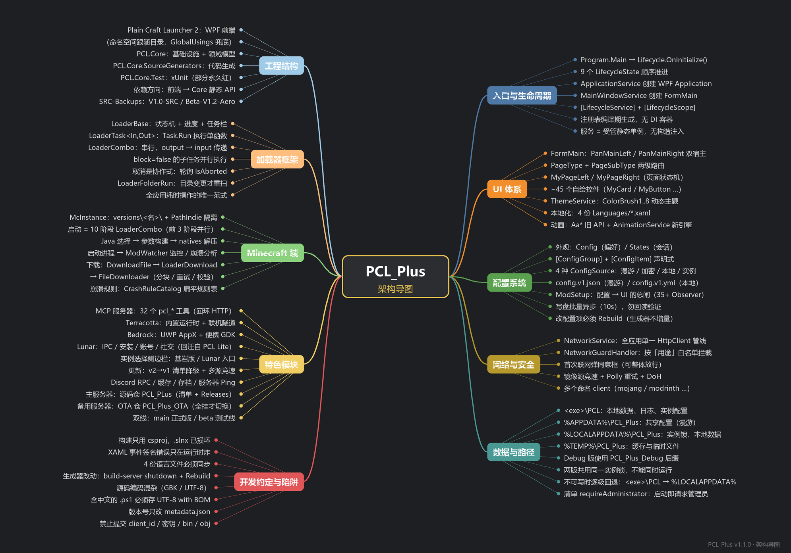

# PCL_Plus 开发者手册

> 面向**要改这个项目的人**。用户向的说明在 [README.md](README.md)。
> 版本：`PCL_Plus v1.0-pre`　·　上游基线：PCL2 `2.12.1`　·　技术栈：.NET 10 + WPF



> 矢量版：[docs/architecture-mindmap.svg](docs/architecture-mindmap.svg)　·　生成脚本：[tools/mindmap_gen.py](tools/mindmap_gen.py)

---

## 1. 这是什么

PCL_Plus 是 [PCL2](https://github.com/Meloong-Git/PCL)（Plain Craft Launcher 2）的下游分支：保留上游全部启动器能力，额外加入 Terracotta 联机、液态玻璃 UI、MCP 服务器、性能状态主页等。代码量约 **900 个 .cs/.xaml 文件、20 万行**，整体是"**WPF 前端 + 核心库 + 编译期代码生成**"的三层结构。

```
Plain Craft Launcher 2.slnx
├── Plain Craft Launcher 2/      WPF 前端（RootNamespace = PCL）
├── PCL.Core/                    基础设施 + 领域模型（无 UI 依赖）
├── PCL.Core.SourceGenerators/   配置项 / 生命周期 / 密钥 生成器
└── PCL.Core.Test/               xUnit 测试（解决方案里被排除生成）
```

依赖方向是单向的：**前端 → Core**。前端从不实现底层能力，只调用 `PCL.Core.*` 的静态 API；Core 不回引前端。

仓库里还有两棵**可直接上传 GitHub 的源码快照**（不含 `bin/`、`obj/`、`publish-*`、`.git`、mp4 与发布包）：

```
PCL_PLus/
├── V1.0-SRC  →  SRC-Backups/V1.0-SRC/          正式线快照（当前 1.1.1R），窗口亚克力关闭
└── V1.2-beta →  SRC-Backups/Beta-V1.2-Aero/    测试线快照（当前 1.5.1-beta），Aero 默认开启
```

两棵树的差别只有 `metadata.json` 版本、`AcrylicHelper`/`ModSetup`/`Config` 的亚克力开关、`PageSetupUI.xaml` 的复选框可见性，外加各自的 `VERSION.md` 与 beta 的 `BETA.md`。**改主仓库后要同步过去**，否则快照会和代码脱节。

### 命名空间约定

前端项目的命名空间**跟随目录**（`PCL.Core` 本来就是这样）：

| 路径 | 命名空间 |
|---|---|
| `FormMain.xaml.cs`、`Program.cs` | `PCL` |
| `Controls/MyCard.cs` | `PCL.Controls` |
| `Modules/Base/ModBase.cs` | `PCL.Modules.Base` |
| `Pages/PageInstance/Saves/…` | `PCL.Pages.PageInstance.Saves` |

类名保持原名（`ModBase`、`MyCard`…），不加目录前缀。为了让改造前那套扁平可见性继续成立，`Plain Craft Launcher 2/GlobalUsings.cs` 里有 33 行 `global using PCL.X.Y;`——**新增目录时要在这里补一行**，否则老代码看不到新命名空间里的类型。

两个例外：

- `GlobalUsings.cs` 本身、以及 `Plain Craft Launcher 2/StringExtensions.cs`（`namespace PCL`，字符串扩展方法）放在根命名空间 `PCL`。字符串扩展方法必须留在 `PCL`，因为 C# 的扩展方法查找是「由内向外、命中即停」，放到 `PCL.Modules.Base` 会和 `PCL.Core.Utils.Exts.StringExtension` 撞成二义（CS0121）。
- XAML 里的 `clr-namespace` 不能通配，必须写具体命名空间；一个文件用到多个命名空间时用 `local:` / `local1:` / `local2:` 分别声明。

---

## 2. 快速开始

### 环境

| 项 | 要求 |
|---|---|
| 系统 | Windows 10 1809+ / Windows 11（x64 或 ARM64） |
| SDK | **.NET 10 SDK**（`dotnet --version` ≥ 10.0.100） |
| IDE | Visual Studio 2022 17.12+ / Rider 2024.3+，需装 .NET 桌面开发工作负载 |

### 构建与运行

```powershell
# 只构建前端工程（推荐，最快）
dotnet build "Plain Craft Launcher 2/Plain Craft Launcher 2.csproj" -c Debug

# 产物
# Plain Craft Launcher 2/bin/Debug/net10.0-windows/Plain Craft Launcher 2.exe
```

> ⚠️ **不要用 `dotnet build "Plain Craft Launcher 2.slnx"`**。`.slnx` 把 `PCL.Core.Test` 标记为"不参与生成"，而 `Debug|AnyCPU` 的解决方案配置里又没给它选平台，导致 Restore 阶段直接失败（输出只有一句 `生成失败。0 个警告 0 个错误`，没有任何错误详情）。要么单独构建 csproj，要么先在 VS 里修好解决方案配置。

调试参数：

- `--debug`：仅 Debug 编译有效，启动时等待调试器附加（`Program.cs`）。
- `--console`：分配控制台窗口，看 `Console.WriteLine` 与未捕获异常。

运行期数据目录（**Debug 与 Release 互不干扰**）：

| 路径 | 内容 |
|---|---|
| `<exe>\PCL` | 本地数据、日志、实例级配置 |
| `%APPDATA%\PCL_Plus`（Debug 为 `PCL_Plus_Debug`） | 共享配置 `config.v1.json` |
| `%LOCALAPPDATA%\PCL_Plus` | 实例锁、Bedrock/本地缓存 |
| `%TEMP%\PCL_Plus` | 下载缓存、SQLite 缓存库 |

目录不可写时**不会崩**：`PCL.Core/App/Paths.cs` 的 `EnsureDirectory` 会写探针验证可写性，失败就逐级回退——
数据目录 → `<exeDir>\PCL` → `%LOCALAPPDATA%`；本地共享目录 → `<数据目录>\Local`；临时目录 → `<数据目录>\Temp`。
所以放在 `C:\Program Files`、只读 U 盘、网络盘里也能起来（见 §11「可移植性」）。

两版**共用** `%LOCALAPPDATA%\PCL_Plus\instance.lock`，所以**不能同时运行** Debug 和 Release；锁建不出来时只记 warn 并继续启动，不会因此退出。

### 出测试包

```powershell
# 单文件（约 27 MB）+ 文件夹版；exe 进 release\，其余进 release-assets\
powershell -ExecutionPolicy Bypass -File tools\build-release.ps1 -All -Portable
```

`release\` 里**只有 exe**；校验值、说明、清单模板、文件夹版都在 `release-assets\`。
`release\` **保留每个版本**：正式版固定叫 `PCL_Plus_x64.exe`，同时自动留一份 `PCL_Plus_v<版本>_x64.exe`；
beta 本来就带版本号。旧版本一律不删（`build-release.ps1` 只覆盖同名文件），要清理只能手动。
产物形态与「%TEMP% 不可写时用文件夹版」的取舍见 [release-assets/README.md](release-assets/README.md)。

---

## 3. 启动链路与生命周期

`Program.Main()` 只做四件事：注册联网同意弹窗 → 挂载 WPF `Application` 工厂 → 挂载主窗口工厂 → `Lifecycle.OnInitialize()`。之后所有初始化都由**生命周期服务**按状态推进。

```
Program.Main
└─ Lifecycle.OnInitialize()
   └─ BeforeLoading → Loading → Loaded → WindowCreating → WindowCreated
      → Running → (Closing) → Exiting
```

| 状态 | 典型工作 |
|---|---|
| `BeforeLoading` | 路径初始化、日志、EventBus、单实例锁 |
| `Loading` | 配置读写（`ConfigService`）、本地化、网络、更新检查 |
| `Loaded` | 主题计算、图标包、MCP 服务器 |
| `WindowCreating` / `WindowCreated` | 构造 `FormMain`、绑定全局事件 |
| `Running` | 后台常驻服务（Discord RPC、内网穿透等） |
| `Closing` / `Exiting` | 保存配置、停止子进程、刷盘 |

### 声明一个服务

```csharp
[LifecycleService(LifecycleState.Loading, Priority = 100)]
[LifecycleScope("myfeature", "我的功能")]        // 生成 Identifier / Name / 无参构造
public sealed partial class MyFeatureService
{
    [LifecycleStart]
    private static void _Start() { /* 在这里初始化 */ }

    [LifecycleStop]
    private static void _Stop() { /* 可选，停止时清理 */ }
}
```

规则与坑：

- 注册表是**编译期生成**的：生成器反射不到运行时类型，改完必须整体重编译。
- 同一个状态内：非异步服务**串行**执行，async 服务并行 `Task.WaitAll`，按 `Priority` **降序**。
- 没有 DI 容器、没有构造函数注入。服务就是"受生命周期管理的静态单例"，实例由 `Activator.CreateInstance(type, true)` 创建。
- 线程约定：`BeforeLoading`~`Closing` 都在 **STA(UI) 线程**；`Running` 的同步服务在**独立工作线程**；`Exiting` 任意线程。
- 服务抛异常会被记录并自动停止，不影响其他服务——但也不会重试。

---

## 4. 配置系统

配置是**声明式**的：写一个 partial 属性，生成器补全读写逻辑。

```csharp
// PCL.Core/App/Config.cs
[ConfigGroup("Download")]
public partial class DownloadConfigGroup
{
    [ConfigItem<int>("ToolDownloadThread", 63, ConfigSource.Shared)]
    public partial int ThreadLimit { get; set; }
}

// 使用
Config.Download.ThreadLimit = 32;
Config.Download.ThreadLimitConfig.Observe(new ConfigObserver(ConfigEvent.Changed, _ => Apply()));
```

两个门面：

- `Config` —— 用户偏好（会持久化）。
- `States` —— 会话状态（窗口尺寸、当前实例等）。

四种存储源：

| `ConfigSource` | 落盘位置 | 适用 |
|---|---|---|
| `Shared`（默认） | `%APPDATA%\PCL_Plus\config.v1.json` | 跨机器、可漫游的偏好 |
| `SharedEncrypt` | 同上，值加密 | Token、密钥类 |
| `Local` | `<exe>\PCL\config.v1.yml` | **机器相关**（路径、窗口位置） |
| `GameInstance` | `<实例>\PCL\config.v1.yml` | 单实例设置（内存、JVM 参数） |

必须记住的语义：

- 写盘是**批量异步**的（默认 10 秒合并一次），落盘用 `File.Replace(tmp, path, bak)` 原子替换，必定留下 `.bak`。**不要靠立刻回读文件来验证保存成功**。
- 配置项 key 字符串是数据主键，**改名 = 丢数据**（需要写 `ConfigMigration`）。
- 生成器**吞掉所有异常**：属性写错不会报编译错误，只是那个 `Config.Xxx` 成员根本不存在，报错出现在调用处。
- 重复 key 不会抛异常，第二个属性会静默指向第一个已注册的值（类型不同则首次访问 `InvalidCastException`）。
- Observer 回调在**调用线程同步执行**。`ModSetup` 里的回调都直接改 UI，所以**配置写入必须在 UI 线程发起**。
- 改配置项后生成器可能不重跑：`dotnet build-server shutdown` 再 `dotnet build ... -t:Rebuild`。

`ModSetup`（`Modules/Base/ModSetup.cs`）是"配置 → UI"的总闸：启动时注册 30+ 个 Observer，并调用 `ApplyAll()` 把当前值全量应用一遍。

---

## 5. UI 体系

### 页面宿主

整个界面只有两个宿主：`FormMain` 里的 `PanMainLeft`（左侧列表）和 `PanMainRight`（右侧内容），页面就是往 `Child` 里塞一个 `UserControl`。

```
FormMain
├─ PanTitleSelect          顶部导航（MyRadioButton，Tag = PageType 数值；当前只有 启动/下载/设置/工具，基岩版已移到实例选择页侧边栏）
├─ PanMainLeft             ← MyPageLeft 子类（PageLaunchLeft 等）
└─ PanMainRight            ← MyPageRight 子类（PageLaunchRight 等）
```

导航用两级枚举：`PageType`（顶级页面）+ `PageSubType`（子页）。切换统一走：

```csharp
ModMain.frmMain.PageChange(new FormMain.PageStackData { page = FormMain.PageType.Setup },
                           FormMain.PageSubType.SetupUI);
```

⚠️ **枚举值与 UI 索引强绑定**：`PageType` 的数值必须等于顶部按钮在 `PanTitleSelect` 里的下标；`PageSubType` 必须等于左侧 `MyListItem.Tag`。改顺序 = 全站跳错页。

### 新增一个页面（5 步）

1. `FormMain.PageType` 加枚举值（不要插在中间，加到末尾）。
2. `FormMain.xaml` 的 `PanTitleSelect` 加一个 `MyRadioButton`，`Tag` = 该枚举值。
3. `ModMain` 加两个字段存页面单例（`frmXxxLeft` / `frmXxxRight`）。
4. 建 `PageXxxLeft : MyPageLeft`、`PageXxxRight : MyPageRight`，XAML 根节点用对应控件。
5. `FormMain` 的 `PageChangeActual` 加 `case PageType.Xxx:` 返回左右页面实例。

右侧页建议直接抄 `PageTools/*` 里任意一页的结构：`MyPageRight` → `MyScrollViewer` → `StackPanel` → 若干 `MyCard`。

### 控件与样式

~45 个自绘控件都在 `Plain Craft Launcher 2/Controls/`，命名一律 `My*`：

| 控件 | 用途 |
|---|---|
| `MyCard` | 卡片容器（圆角、边框、可选标题、可折叠） |
| `MyButton` / `MyIconButton` / `MyTextButton` | 主按钮 / 图标按钮 / 文字按钮 |
| `MyListItem` | 左侧导航项、列表行 |
| `MyTextBox` / `MyComboBox` / `MySlider` / `MyCheckBox` | 输入控件 |
| `MyLoading` | 加载动画（由 `LoaderBase` 驱动） |
| `MyScrollViewer` / `MyVirtualizingElement<T>` | 滚动与虚拟化 |
| `MyHint` / `MyToast` | 提示条 |

主题色统一走 `{DynamicResource ColorBrush1..8}`（1 主文字、2 按钮、3 悬停、4 边框、5 强调、6 卡片边、7 分割线、8 页面背景），由 `ThemeService` 在运行时重算并写回 `Application.Resources`。**XAML 里一律用 `DynamicResource`，不要写死颜色**，否则切主题不刷新。

### 本地化

四份文件必须同步维护：`PCL.Core/App/Localization/Languages/{zh-CN,zh-TW,en-US,en-GB}.xaml`。

```xml
<sys:String x:Key="Page.MyFeature.Title">我的功能</sys:String>
```

- XAML：`Text="{DynamicResource Page.MyFeature.Title}"`
- C#：`Lang.Text("Page.MyFeature.Title")`
- 缺 key 时 Debug 显示 `!key!`，Release 显示裸 key——**不会崩，只会很难看**，所以务必四份都加。
- 诊断日志（`ModBase.Log`）保持中文，**不要**走本地化。

### XAML 事件签名的坑

XAML 事件处理器是**按名字反射绑定**的：签名写错编译能过，运行时才抛 `XamlParseException`。

| 控件 | 第二参数类型 |
|---|---|
| `MyButton` / `MyExtraButton` / `MyListItem` | `MouseButtonEventArgs` |
| `MyIconTextButton` | `ModBase.RouteEventArgs` |
| `MyIconButton` / `MyTextButton` | `EventArgs` |
| 原生 `Button` | `RoutedEventArgs` |
| `MyCheckBox.Change` | `(object sender, bool user)` |
| `MyComboBox.SelectionChanged` | `SelectionChangedEventArgs` |

提交前可跑 `python tools/audit-xaml-events.py` 自检。

---

## 6. 加载器框架（异步任务）

全应用**所有**耗时操作都必须包装成 Loader，否则没有进度、不能取消、不进任务栏。

```csharp
var loader = new ModLoader.LoaderTask<string, int>("Loader MyTask", t =>
{
    ModBase.Log("开始");
    for (var i = 0; i < 10; i++)
    {
        ModBase.CheckCancelled();          // 协作式取消检查
        t.Progress = (i + 1) / 10d;        // 0~1 进度
        Thread.Sleep(100);
    }
    t.output = 42;
});
ModLoader.LoaderTaskbarAdd(loader);
loader.Start();
```

三种组合：

| 类型 | 语义 |
|---|---|
| `LoaderTask<In, Out>` | 单函数任务，`Task.Run` 执行，异常自动捕获并弹提示 |
| `LoaderCombo` | 串行组合，子任务的 `output` 自动喂给下一个的 `input` |
| `LoaderFolderRun` | 扫描目录，内容未变则复用上次结果（省掉重复扫盘） |

- `loader.block = false` 时，同 Combo 内多个子任务可并行。
- 取消靠轮询 `IsAborted`，不会硬杀线程；`ThreadInterruptedException` 也要接住。
- 进度条会做平滑（`progress * 0.9 + new * 0.1`），所以看起来"慢半拍"是正常的。

---

## 7. Minecraft 域

### 实例

标准 `.minecraft` 布局，每个实例是 `versions/<名称>/`，带 `PathIndie` 隔离目录（存档、资源包、配置互不污染）。`McInstance` 是内存模型，`ModInstanceList` 负责扫描与缓存。

### 启动链

启动 = 一个 10 阶段的 `LoaderCombo`，前 3 阶段并行：

```
1 GetJava(选择 Java)  ─┐
2 Login(登录/换号)     ├─ 并行
3 CompleteFiles(补全)  ─┘
4 GetArguments(拼参数) → 5 ExtractNatives(解压) → 6 PreLaunch(预处理)
→ 7 CustomCommand(自定义) → 8 StartProcess(起进程)
→ 9 WaitWindow(等窗口) → 10 End(收尾)
```

- 入口：`ModLaunch.McLaunchStart()`，必须在 UI 线程调用；已有启动任务在跑时直接拒绝。
- 第 9 阶段会挂 `ModWatcher`，进程退出时触发崩溃分析。
- Java 版本按 MC 版本自动选：1.20.5+ → 21，1.18+ → 17，1.17 → 16，2017 年前 → 8。

### 下载链

```
DownloadFile(urls, localPath, FileChecker)   // 描述"要下什么"
  └─ LoaderDownload(名称, List<DownloadFile>) // 包成任务
       └─ FileDownloader.DownloadAsync(...)   // 真正下载：分块、重试、校验
            └─ FileChecker.Check(path)        // 大小 / SHA1 校验
```

镜像源在 `ModDownload.DlSourceOrder` 里配置，支持竞速与降级；小文件（< 4 MiB）走单线程顺序下载。

### 崩溃分析

`CrashAnalyzer` 收集日志 → 规则匹配 → 输出可读结论。规则是一张扁平表（`CrashRuleCatalog.Rules`），加规则只需：新增 `CrashCause` 枚举值 + 加一行 `_Contains(DetectionPhase.Primary, CrashLogKind.Game, "<日志片段>", CrashCause.X)`。

---

## 8. 网络与安全

- 全应用只有一个 HTTP 客户端管线（`NetworkService`），按用途分多个命名 client（`mojang_session`、`modrinth_api`、`cache` …）。
- `NetworkGuardHandler` 按"用途 → 域名白名单"拦截，未登记的请求会被拒。
- 首次联网会弹同意框；`ConsentRequested == null` 视为**拒绝**（默认拒绝）。
- 需要新域名时，在 `NetworkPurposeCatalog` 里登记用途，而不是绕过 Guard。

---

## 9. 特色模块

| 模块 | 入口 | 说明 | 状态 |
|---|---|---|---|
| **MCP 服务器** | `PCL.Core/Mcp/McpServerService.cs` | 回环 HTTP + JSON-RPC，32 个 `pcl_*` 工具，能力开关默认关闭 | 可用 |
| **Terracotta 联机** | `Modules/Terracotta/TerracottaAddon.cs` | 内置 `terracotta.exe`，自动解压到 `%LOCALAPPDATA%\PCL\Terracotta\` | 可用（启动时按需提权） |
| **Bedrock** | `Modules/Minecraft/ModBedrockRuntime.cs` | UWP AppX + 便携 GDK | 可用 |
| **自动更新** | `Modules/Updates/UpdateManager.cs` | 清单 v2→v1 降级、多源竞速 | 可用（静默更新已移除） |
| **Discord RPC** | `Modules/ModDiscord.cs` | 5 秒刷新一次状态 | 可用 |
| **缓存服务** | `PCL.Core/IO/Storage/Cache/CacheService.cs` | SQLite + 文件双层，2 GiB 上限 | 可用 |
| **存档管理** | `PCL.Core/Minecraft/Saves/SaveManager.cs` | fNbt 读写 `level.dat`（仅少量字段可写） | 可用 |
| **服务器 Ping** | `PCL.Core/Link/McPing/` | 现代握手 + 旧版 0xFE | 可用 |

---

## 10. 开发约定（务必遵守）

1. **构建只用 csproj**，`.slnx` 目前是坏的。
2. **XAML 事件签名必须匹配**，否则运行时炸；改完 XAML 至少跑一次界面。
3. **四份语言文件同步**，否则英文用户看到中文。
4. **不提交** `client_id`、密钥、`bin/`、`obj/`、`publish-*/`、签名证书。
5. 版本号只改 `Plain Craft Launcher 2/metadata.json`，不要动 csproj，也不要改 `update.json`。
6. 用 `Visibility.Collapsed` 而不是 `IsEnabled="false"` 来表达"不可用"。
7. 图标放 `PCL.Core/UI/Assets/IconPacks/`，自有图标进 `brand/`（`lucide/` 是第三方 ISC）。
8. 大块 UI 改动后手动检查深色模式；原生 `TextBox`/`RichTextBox` 必须显式设 `Foreground`。
9. 改完主仓库要**同步到 `SRC-Backups\` 两棵树**（`V1.0-SRC`、`Beta-V1.2-Aero`），否则快照会和代码脱节；同步后各自编译一次。
10. 含中文的 `.ps1` 必须存成 **UTF-8 with BOM**，否则 PowerShell 5.1 按 ANSI 读会把中文变成乱码。

### 源码编码

仓库里**混着 GBK 和 UTF-8**（`LoaderDownload.cs`、`ModNet.cs`、`GameCore.cs`、`MavenArtifact.cs`、`LaunchEnvUtils.cs`、`CrashAnalyzer.cs` 是 GBK）。用 PowerShell 的 `Get-Content -Raw | Set-Content` 批量改文件会把中文变成乱码——请用编辑器或 `write` 工具按 UTF-8 写。

判断一个文件到底是什么编码，别信控制台显示（`Get-Content` 可能把合法 UTF-8 中文显示成 `涓嬭浇`），用严格解码探一下：

```powershell
[Text.UTF8Encoding]::new($false, $true).GetString([IO.File]::ReadAllBytes($path))
# 抛异常 = 不是 UTF-8；不抛 = UTF-8，可以放心用 edit 改
```

### 测试

```powershell
dotnet test PCL.Core.Test
```

已知**环境性失败**（不是你的锅）：代理配置非法导致 `UriFormatException: Invalid port`、LiteDB 文件锁、脱离 UI 生命周期时 EventBus 未初始化。`LocalizationTest.FontProfileShouldFollowCultureGlyphStandard` 是**永久红**，忽略。

---

## 11. 当前状态与已知缺口

- ✅ 上游功能完整（启动、下载、模组、整合包、资源包、光影、存档、日志、崩溃分析）。
- ✅ Terracotta 联机、液态玻璃、PCL_Plus 品牌与主页性能卡片已落地。
- ✅ **Lunar Client 支持已从 PCL Lite 回迁并接线**：`PCL.Core/App/Lunar`（IPC / 安装 / 账号 / 社交）、`Modules/Lunar`、`Pages/PageLunar`、设置里的 `Lunar` 页；入口在**实例选择页侧边栏**的「平台」分组（「基岩版」「Lunar Client」），不占顶栏按钮。
- ✅ 页面切换的外壳修复来自 donor：`PageChangeAnim` 两栏合并为同一组动画（消除撕裂）、`AniControlEnabled` try/finally、导航按钮按 `Tag` 查找、原生 `ScrollBar`/`ScrollViewer` 样式、多行输入弹框。
- ✅ 前端命名空间已从扁平 `PCL` 改为**目录即命名空间**（见 §1「命名空间约定」）。
- ✅ 清单**回到 `requireAdministrator`**（v1.2 起）：「产物一启动就请求管理员权限」，任意目录双击即可，不再需要手动选「以管理员身份运行」；代价是每次启动一次 UAC。目录不可写时的逐级回退仍然保留，降权运行时也不会崩。
- ✅ 开发者署名为 `xL1nUwU`：`csproj` 的 `Company`/`Authors`/`Copyright`、关于页首屏「开发者」一行（`Setup.About.Developer.*`，4 份语言文件齐全）。
- ✅ 可移植性：`Paths` 目录回退 + 写探针（不可写不崩）、单例锁失败只 warn、启动未捕获异常写 `PCL\Log\crash-*.log` 并弹窗。
- ✅ 正式版（`main`）窗口亚克力仍**关闭**：`AcrylicHelper.IsEnabled => false` + `ModSetup` 强制 `AcrylicEnabled = false`，只保留按钮液态玻璃。
- ✅ beta（`beta` 分支）亚克力**默认开启**：`AcrylicHelper` 按深浅色两套配色（卡片 74–78% 不透明度保证正文可读），设置页复选框也恢复显示。
- ✅ 更新链按分支：`ProjectLinks.ManifestBranch` 依版本后缀选 `main` / `beta`（详见 §12）。
- ⚠️ 静默更新、Quilt 安装已被移除，相关入口仍有残留文案。
- ⚠️ 仓库里仍有多处 `Plain Craft Launcher Community Edition` 字样与旧图标资源。
- ⚠️ 安装包 / 自动更新签名 / 代码签名尚未完成。
- 📄 待办散落在代码注释里：`ModComp.cs:2908`、`ModLocalComp.cs:2626`、`ModModpack.cs:1420`、`PageInstanceInstall.xaml.cs:1145`、`PageLogLeft.xaml.cs:147`。

---

## 12. 仓库与更新链路

本项目用**两个仓库**，一主一备：

| 仓库 | 角色 | 放什么 |
|---|---|---|
| 源码仓 [`x1B1C1/PCL_PLus`](https://github.com/x1B1C1/PCL_PLus) | **主 OTA 服务器** | 代码、Issue、PR、README、docs，根目录的 `update.json` / `updatev2.json`，以及每个版本的 exe 与 SHA-256 |
| OTA 仓 [`x1B1C1/PCL_Plus_OTA`](https://github.com/x1B1C1/PCL_Plus_OTA) | **备用服务器**（主服务器不可用时才切换） | 内容完全相同的清单 + 同一批 Release 资产 |

对应到代码（`PCL.Core/App/ProjectLinks.cs`）：

| 常量 | 指向 | 用途 |
|---|---|---|
| `GitHubOwner` / `GitHubRepo` | 源码仓 | Issue、PR、README、贡献者等所有非发布链接 |
| `ServiceOwner` / `ServiceRepo` | **主 OTA 服务器**（= 源码仓） | 更新清单三条通道（raw / jsDelivr / Contents API）+ Releases 兜底源 |
| `ExtraServiceAnchors` | 备用服务器（`x1B1C1/PCL_Plus_OTA`） | 主服务器全部通道都失败时才登场；主服务器正常时零额外请求 |

### 两条更新线

| 分支 | 版本 | 客户端何时读它 | 清单位置 |
|---|---|---|---|
| `main` | 正式版（`1.1.1R`、`1.1.1` …） | 版本后缀不以 `beta` 开头 | 主服务器 / 备用服务器 `main` 分支的 `update.json` / `updatev2.json` |
| `beta` | 测试版（`1.5.1-beta` …） | 版本后缀以 `beta` 开头 | 两边 `beta` 分支的同名文件 |

> 发布标记 `R`：`metadata.json` 的 `suffix` 写 `R` 表示正式版，界面显示贴在一起（`1.1.1R`），GitHub tag 与产物名仍是 `v1.1.1-R`。`UpdateChannelLevels` 把 `R` 判成正式通道，`UpdateVersion` 把 `1.1.1R` 与 `1.1.1-R` 归一成同一版本——这两处不改，稳定通道会开始收 beta 更新，或者「检查更新」会一直提示有新版本。

分支由 `ProjectLinks.ManifestBranch` 从 `metadata.json` 的 `suffix` 推出，**与用户在设置里选的更新通道无关**——正式版永远读 `main`，beta 包永远读 `beta`，想换线只能换包。发测试版就改两边 `beta` 分支的清单，正式版走 `main`，两边 Release 资产共享。

更新链路：

```
客户端 → 主服务器 PCL_PLus 的 updatev2.json（多源 + 权重，失败退回 update.json）
       → 主服务器全部通道都失败 → 切到备用服务器 PCL_Plus_OTA 的同一份清单
       → 每个源再落到对应仓库的 releases/latest
       → 挑资产（文件名含 x64 / arm64 优先）→ 校验 SHA-256 → 下载
```

⚠️ 两个仓库根目录的 `update.json` 都写 `{"update": "self"}`，内容是**逐字节相同的**；`self` 展开的是主服务器（`ServiceRepo`）。发布包要同时传到两个仓库的同一个 tag，只传一边会出现「清单拿到了、包下不到」。换发布位置的步骤见 [docs/UPDATE.md](docs/UPDATE.md)。

---

## 13. 相关文档

| 文档 | 内容 |
|---|---|
| [docs/CONTRIBUTE.md](docs/CONTRIBUTE.md) | 贡献流程、PR 规范、代码风格细则 |
| [docs/BUILD.md](docs/BUILD.md) | 完整构建与发布流程 |
| [docs/CONFIG.md](docs/CONFIG.md) | 配置文件结构详解 |
| [docs/THEME.md](docs/THEME.md) | 主题色算法与配色规范 |
| [docs/UPDATE.md](docs/UPDATE.md) | 更新清单格式与发布流程 |
| [docs/MCP.md](docs/MCP.md) | MCP 工具清单与接入方式 |
| [docs/TERRACOTTA.md](docs/TERRACOTTA.md) | 联机模块实现细节 |

---

<div align="center">

**PCL_Plus v1.0-pre**　·　MIT + Copyleft　·　用 .NET 10 与 WPF 写成

</div>
