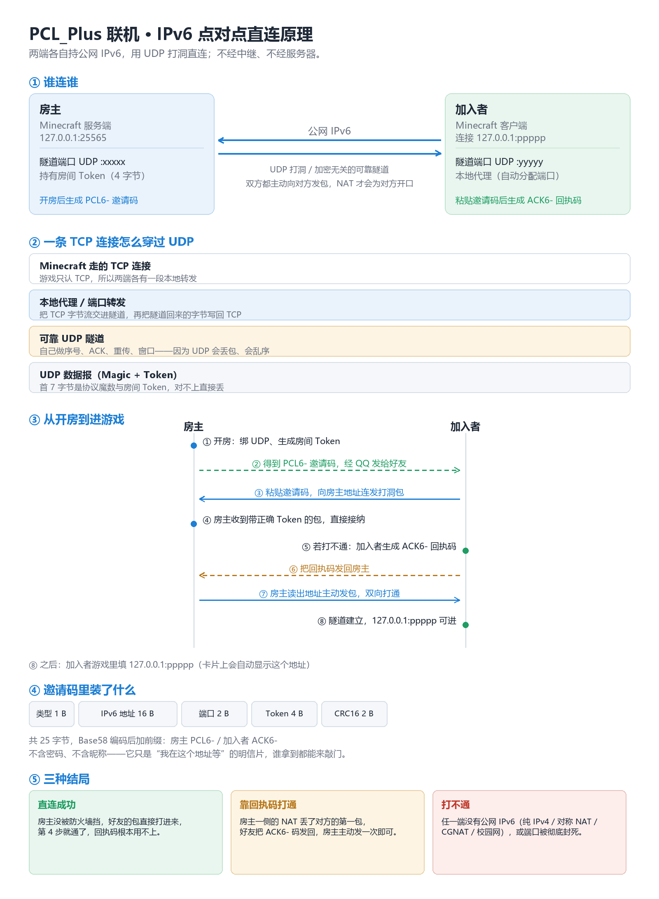

# 联机（IPv6 直连）

工具页 → 联机（功能栏第五个入口）。两端各持公网 IPv6，用 UDP 打洞直连，不经中继、不经服务器。



## 三个物件

**邀请码 `PCL6-…`** —— 房主开房时生成。25 字节定长载荷（类型 1 B + IPv6 地址 16 B + UDP 端口 2 B + 房间 Token 4 B + CRC16 2 B），Base58 编码。它只说明「到哪个地址、敲哪个端口、带哪个 Token」，不含昵称、不含密码、不含房间内容。

**回执码 `ACK6-…`** —— 加入者粘贴邀请码后生成，结构相同但类型不同，Token 用的是房主的。只在「打洞打不通」时才需要，靠人（QQ、微信）传回房主。

**房间 Token** —— 4 字节随机数，房主开房时生成，随邀请码流出去。数据包首 7 字节是协议魔数 + Token，对不上的包直接丢弃。

## 一条 TCP 怎么穿过 UDP

Minecraft 只认 TCP，所以两端各有一段本地转发：

```
MC 客户端 ──TCP──> 本地代理 ──> 可靠 UDP 隧道 ──> UDP 数据报 ──> 公网 IPv6
                                                                      │
MC 服务端 <──TCP── 房主本机端口 <── 可靠 UDP 隧道 <── UDP 数据报 <─────┘
```

`UdpReliableTunnel` 自己做序号、ACK、重传与重组——因为 UDP 会丢包、会乱序，而 MC 的协议假设底下是可靠流。

## 打洞为什么能成

UDP 打洞的前提是**双方都主动向对方发过包**，NAT 才会为对方的地址开口。房主开房后并不知道谁会来，加入者从邀请码里知道房主地址，于是：

1. 加入者先发包 → 房主若没被防火墙挡，直接收到、直接接纳（第 4 步就通了，回执码根本用不上）。
2. 房主若在 NAT 后面，加入者的包进不来，房主不知道该往哪发 → 加入者把自己的地址编成 `ACK6-` 码，经人转交；房主读出来后主动连发打洞包，双向开口。

## 边界

- 任一端**没有公网 IPv6**（纯 IPv4、对称 NAT、CGNAT、校园网），打洞必然失败，只能换网络环境。
- 端口被彻底封死同样失败。
- Token 随邀请码泄露：**拿到邀请码的人都能尝试连进来**。它是门牌号，不是门锁——房间里的事由 Minecraft 自己的正版验证负责。

## 想改的地方

- 协议实现：`PCL.Core\Link\Ipv6Direct\`（`Ipv6DirectService.cs` 是房主/加入者两个会话，`UdpReliableTunnel.cs` 是可靠层，`InviteCodeCodec.cs` 是编码）。
- 界面：`Plain Craft Launcher 2\Pages\PageLink\PageLinkRight.xaml(.cs)`。
- 重新生成这张图：`python tools/link_diagram.py docs/link-diagram.png`。
